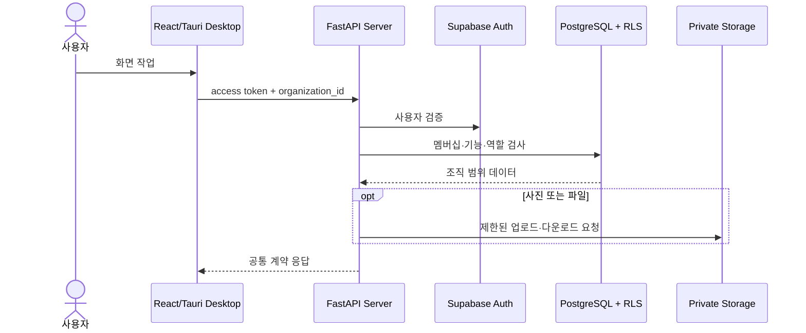

# 구조와 데이터 흐름

## 저장소 구조

```text
business-assistant/
├─ apps/
│  ├─ desktop-react/ React/Tauri 데스크톱 앱
│  └─ server/        FastAPI 서버와 Supabase 어댑터
├─ packages/common/  공통 모델, 오류와 API 계약
├─ migrations/       번호 순서의 Supabase SQL
├─ scripts/          실행, 검증, DB 테스트와 화면 미리보기
├─ docs/
│  ├─ guide/         배포 가능한 사용자·운영·개발 가이드
│  ├─ product/       기능 ID와 검증 상태의 단일 출처
│  └─ screenshots/   화면 검증 자료
├─ mkdocs.yml        문서 사이트 구성
└─ pyproject.toml    uv 워크스페이스와 공통 도구 설정
```

## 요청 흐름



데스크톱은 운영 데이터베이스에 직접 연결하지 않습니다. 서버가 모든 보호 작업에서 조직과 권한을 검사하고, PostgreSQL RLS가 두 번째 경계를 제공합니다.

## 메뉴와 구현 페이지

메뉴의 기준은 `apps/desktop-react/src/features/shell/TopBar.tsx`와 `apps/desktop-react/src/app/routes.tsx`입니다. 메뉴를 추가할 때는 다음을 함께 변경합니다.

1. 기능 ID와 제품 계획
2. 공통 API 계약
3. 서버 조직·역할·기능 검사
4. 데스크톱 상태와 오류 처리
5. DB RLS와 인덱스
6. 테스트와 이 가이드

## 문서의 책임 분리

- `docs/guide`: 사용자가 무엇을 어떻게 하는지 설명합니다.
- `docs/product`: 기능이 무엇을 보장하며 어디까지 검증됐는지 기록합니다.
- `docs/superpowers`: 설계 결정과 구현 계획을 보존합니다.
- 릴리스 문서: 특정 마이그레이션과 버전 동시 적용 절차를 기록합니다.
