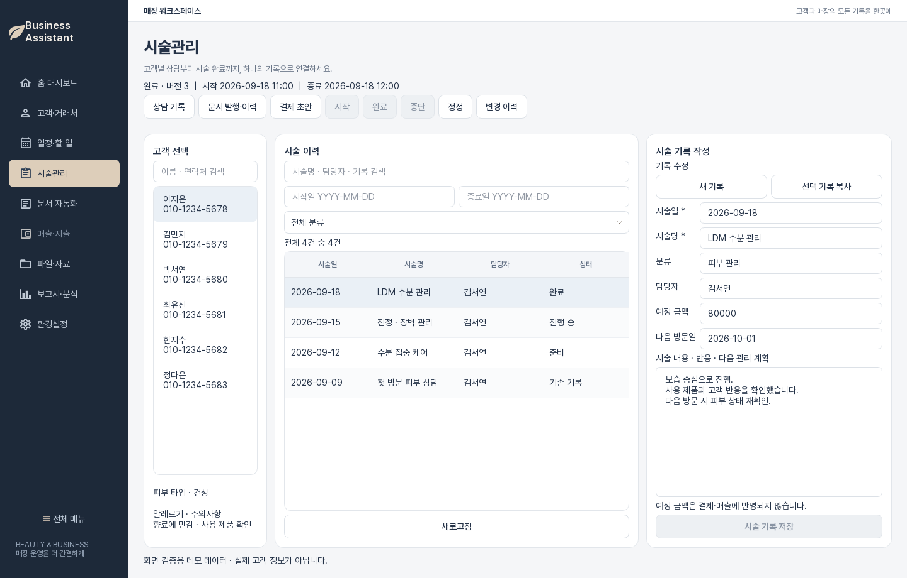

# 화면 구성과 기본 조작

## 화면의 네 영역

1. **왼쪽 메뉴**: 홈, 고객, 일정, 시술, 문서, 매출, 파일로 이동합니다.
2. **상단 조직 표시**: 현재 작업 중인 매장을 확인합니다.
3. **목록 영역**: 고객이나 기록을 검색하고 선택합니다.
4. **상세 영역**: 선택한 항목을 조회하고 수정합니다.

## 왼쪽 메뉴 사용

기본 화면은 자주 쓰는 메뉴만 보여 줍니다. 하단의 **전체 메뉴**를 누르면 구독·계정·설정과 준비 중 메뉴까지 펼쳐집니다. 권한이 없는 메뉴는 비활성화되고 설명 말풍선에 필요한 권한이 표시됩니다.

| 메뉴 | 용도 |
| --- | --- |
| 홈 대시보드 | 고객, 할 일, 파일 현황을 요약해서 확인 |
| 고객·거래처 | 고객 정보, 상담 활동, 사진 관리 |
| 일정·할 일 | 업무 마감일과 진행 상태 관리 |
| 시술관리 | 상담, 동의, 시술 기록과 변경 이력 |
| 문서 자동화 | 서식 관리와 반복 문서 초안 작성 |
| 매출·지출 | 기간별 수입·지출과 결제 장바구니 |
| 파일·자료 | 조직 공용 파일 업로드·다운로드·보관 |

## 작성 중 보호

고객 정보, 시술 기록, 문서 또는 업무를 수정하다 다른 메뉴로 이동하거나 앱을 닫으면 화면별 확인 창이 나타납니다. 표시되는 선택지는 작업에 따라 다릅니다. 저장 가능한 화면은 저장·변경 취소·계속 작성 중 필요한 선택지를 제공하고, 통신 중인 금액·재고 작업은 결과가 확인될 때까지 이동을 막을 수 있습니다. 확인 창의 문구와 현재 저장 상태를 읽고 선택합니다.

## 새로고침과 재시도

단순 조회 실패는 **새로고침**으로 최신 데이터를 다시 불러옵니다. 수납, 입고, 회원권 사용, 환불처럼 금액이나 재고를 바꾸는 작업은 일반 새로고침 대신 화면에 표시된 **같은 요청 재시도** 또는 **미확인 … 다시 확인** 버튼을 사용합니다. 이 버튼은 같은 요청 식별자로 결과를 확인해 중복 기록을 막습니다.

!!! danger "중복 작업 주의"
    결과를 확인하지 못했다고 새 방문을 만들거나 금액을 다시 입력하지 마세요. 먼저 미확인 복구 버튼으로 원래 요청의 결과를 확인합니다.
