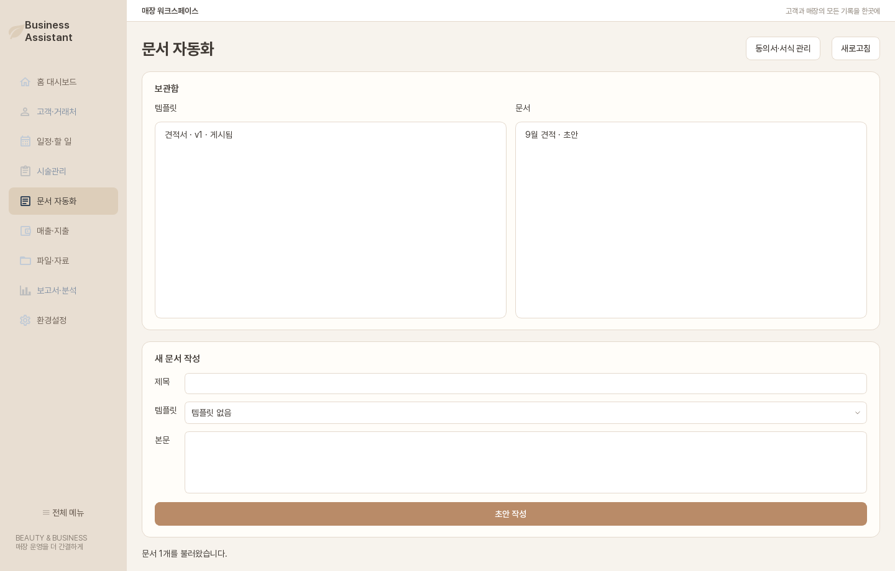
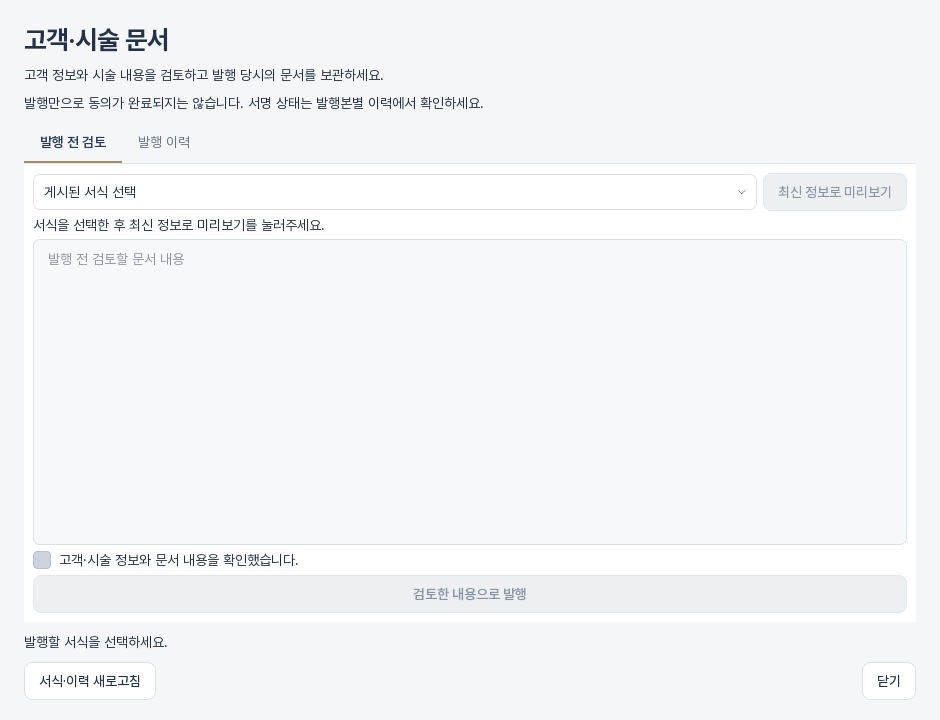

# 문서 자동화

문서 자동화는 반복 문서 초안을 작성하고 시술관리에서 사용할 동의서·서식의 버전을 관리합니다.

## 일반 문서 초안

1. 문서 템플릿을 선택합니다.
2. 제목과 본문을 확인합니다.
3. **초안 작성**을 누릅니다.
4. 생성된 문서를 목록에서 확인합니다.

## 동의서·서식 관리

관리 권한이 있는 사용자는 **동의서·서식 관리**에서 서식 내용을 만들고 버전을 발행합니다. 이미 시술에 발행된 문서는 이후 서식이 바뀌어도 당시 버전과 채워진 값을 유지합니다.

## 시술에서 문서 발행

1. 고객과 저장된 시술을 선택합니다.
2. 문서 화면을 열어 서식을 선택합니다.
3. 자동 채움 값을 검토합니다.
4. 문서를 발행합니다.
5. 현장 서명, 외부 교부 또는 철회 상태를 기록합니다.

!!! info "불변 발행 기록"
    발행된 문서는 일반 편집 문서와 다릅니다. 법적·업무 증거를 위해 원문을 덮어쓰지 않고 후속 이벤트를 추가합니다.
