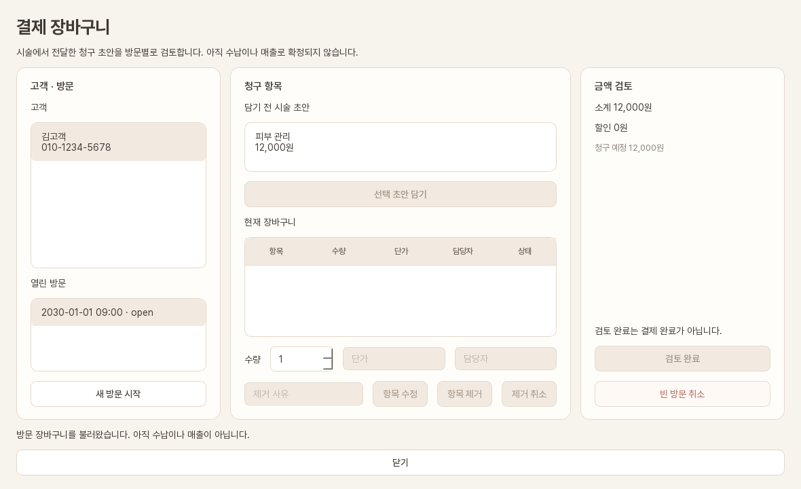
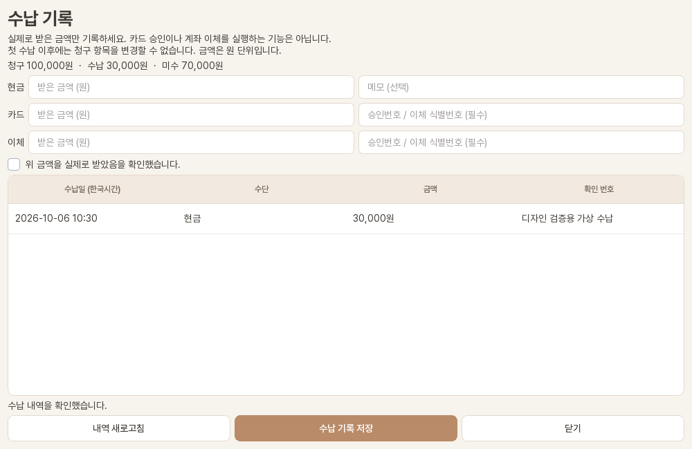

# 장바구니·결제·회원권

**매출·지출 → 결제 장바구니**에서 고객의 방문, 시술 초안, 상품·회원권, 수납과 환불을 한 흐름으로 처리합니다.

## 방문 장바구니 만들기

1. 고객을 선택하고 **새 방문 시작**을 누릅니다.
2. 저장된 시술 결제 초안을 선택해 **선택 초안 담기**를 누릅니다.
3. 상품이나 회원권은 **선택 상품 · 회원권 담기**로 추가합니다.
4. 수량, 단가와 담당자를 확인합니다.
5. 잘못된 항목은 사유를 입력해 **항목 제거**합니다. 되돌리려면 **제거 취소**를 누릅니다.
6. 금액이 맞으면 **검토 완료**를 누릅니다.

검토가 끝난 뒤에는 수납 원장을 보호하기 위해 청구 항목과 금액을 임의로 변경할 수 없습니다.

## 상품과 회원권 관리

**상품 · 회원권 관리**에서 SKU, 이름, 단위, 판매가와 회원권 혜택을 등록합니다. 실물 상품은 **선택 상품 입고**로 재고와 입고 사유를 기록합니다. 같은 입고 요청의 결과가 불명확하면 **같은 요청 재시도**를 사용합니다.

## 현금·카드·이체 수납

1. 검토 완료된 방문에서 **수납 기록 · 내역**을 누릅니다.
2. 현금, 카드 또는 이체 금액을 입력합니다.
3. 카드·이체는 승인번호나 이체 식별번호를 입력합니다.
4. 실제 수납 확인 항목을 체크합니다.
5. **수납 기록 저장**을 누릅니다.

수단을 나눠 복합 결제할 수 있고 일부 금액만 받아 미수금을 남길 수 있습니다. 입력 합계가 남은 미수금보다 클 수 없습니다.

## 회원권 사용

**고객 회원권 · 잔여 혜택**에서 사용 가능한 금액권·횟수권을 확인합니다. 차감할 시술 항목과 혜택을 선택하고 **회원권 사용**을 누릅니다. 사용액과 현금성 수납은 함께 미수금에서 차감됩니다.

관리자는 고객 회원권 목록에서 정지·재개·기간 연장을 사유와 함께 기록할 수 있습니다. 정지 중에는 혜택을 사용할 수 없고, 재개하면 정지 일수만큼 만료일이 연장됩니다. 저장 결과가 불명확하면 **이전 요청 재확인**으로 같은 요청을 확인합니다. SQL 035 적용 뒤 사용할 수 있습니다.

## 환불과 사용 취소

수납 내역의 **환불 · 사용 취소**에서 원거래를 선택합니다. 현금·카드·이체는 환불 가능 잔액 안에서 부분 또는 전체 환불할 수 있습니다. 회원권 사용은 현재 전체 취소만 지원합니다. 사유와 확인 항목을 입력한 뒤 **환불 기록**을 누릅니다.

!!! danger "결과 미확인"
    저장 중 네트워크가 끊기면 새 수납이나 환불을 만들지 마세요. **미확인 수납 다시 확인** 또는 **미확인 환불 다시 확인**으로 같은 요청의 결과를 확인합니다.

## 미수와 일 마감

**매출·지출 → 미수·일 마감**에서 영업일을 선택하면 결제수단별 수납·환불 합계, 예상 현금 시재와 현재 미수 고객을 확인할 수 있습니다. 예상 시재는 당일 현금 수납에서 당일 현금 환불을 뺀 값입니다. 카드·이체 환불은 각 수단의 합계에 따로 표시합니다.

owner/admin은 실제 현금 시재와 사유를 입력하고 **마감 저장**을 누릅니다. 이미 마감한 날의 정정은 이전 기록을 보존한 채 새 버전과 정정 사유를 추가합니다. 잘못된 날짜를 마감하지 않도록 선택한 영업일과 실제 시재를 먼저 확인하세요.

마감 날짜로 귀속되는 수납·환불은 더 추가할 수 없습니다. 과거 영업일 재개방이나 소급 입력은 지원하지 않습니다. 운영점에서 자정 전후 영수증과 늦게 확인한 결제를 어떻게 처리할지는 업무 정책으로 먼저 정해야 합니다.
