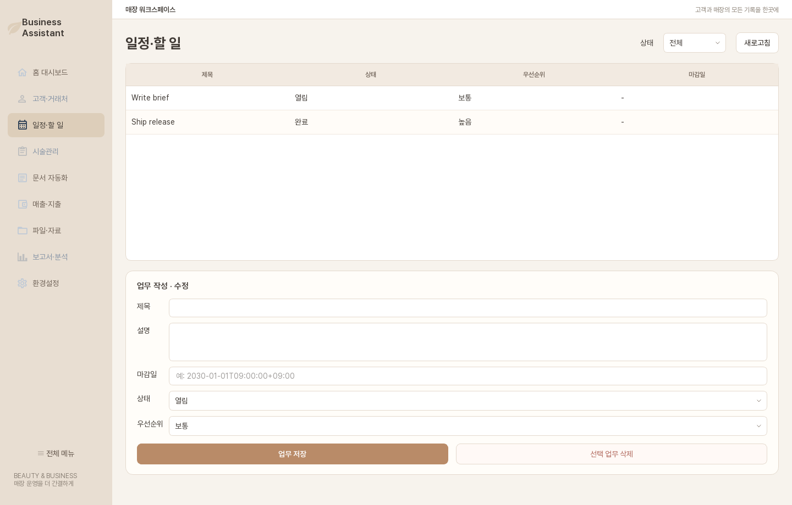
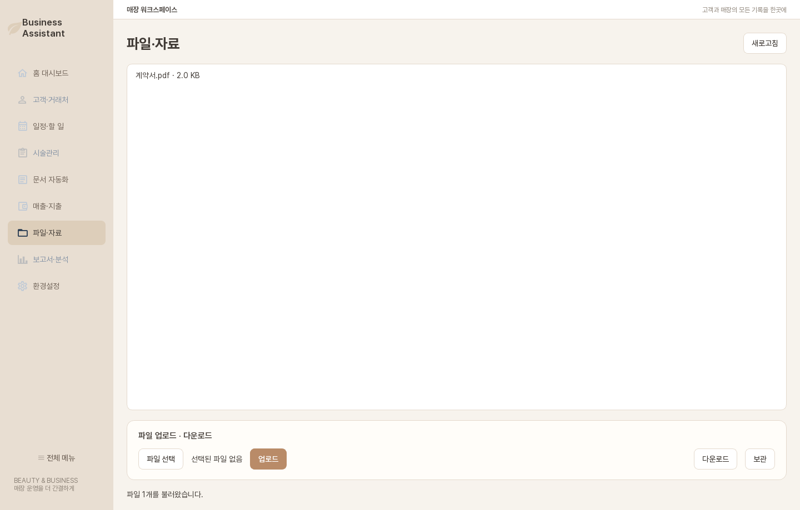
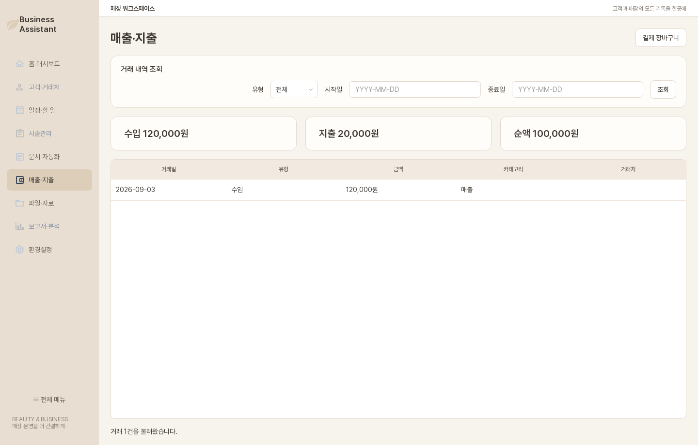

# 일정·파일·매출지출

## 일정·할 일

**예약** 탭에서 관리자는 **담당자 추가**와 **서비스 추가**로 최소 마스터를 등록합니다. **근무시간·휴무**에서 선택한 담당자의 요일별 근무시간과 휴무 기간을 관리합니다. 고객·서비스·담당자·시간대가 포함된 시작 시각을 선택해 **예약 저장**을 누릅니다. 기존 예약을 선택해 시간을 바꾸거나 **확정**, **방문 처리**, **완료**, **노쇼**, **취소**로 상태를 바꿀 수 있습니다. 취소에는 사유가 필요하며 방문 처리 시 같은 고객의 방문 장바구니가 생성됩니다. 방문 처리된 예약은 **시술관리 열기**로 해당 고객의 시술관리 화면을 열 수 있습니다. 같은 담당자의 서비스 시간과 여유 시간이 겹치거나 근무시간 밖·휴무 중이면 저장이 거절됩니다.

**할 일** 탭에서는 업무 제목, 상태, 마감일과 설명을 입력해 **업무 저장**을 누릅니다. 기존 업무를 선택하면 내용을 수정할 수 있고, 필요하면 **선택 업무 삭제**로 제거합니다. 마감일은 화면 안내에 맞는 날짜·시간 형식을 사용합니다.

기본 예약은 SQL 034, 근무시간·휴무 차단은 SQL 037 적용 뒤 동작합니다. 공간·장비 충돌과 시술 원장 자동 시작은 아직 지원하지 않습니다.

## 파일·자료

1. **파일 선택**으로 로컬 파일을 고릅니다.
2. **업로드**를 누릅니다.
3. 목록에서 파일을 선택해 **다운로드**하거나 **보관**합니다.

파일 본문은 비공개 Supabase Storage에 저장하고 목록에는 조직별 메타데이터를 기록합니다. 다운로드 링크는 제한된 시간 동안만 유효합니다.

## 매출·지출

시작일과 종료일을 입력해 **조회**를 누르면 수입, 지출과 순액을 확인할 수 있습니다. 결제에서 확정된 수납은 재무 수입 원장으로 연결되고, 환불은 반대 지출 원장으로 기록됩니다. 장바구니를 열려면 **결제 장바구니**를 누릅니다.

관리자는 **운영 수지·담당 매출**에서 기간별 기록된 수입·지출·순액과 완납 방문의 담당 판매 항목 총액을 볼 수 있습니다. 이 화면은 SQL 036 이후 사용할 수 있습니다. 재고 원가·수당·세금과 할인/환불 배분이 빠져 있으므로 최종 이익이나 확정 수당으로 사용하지 않습니다.

!!! note "예상과 확정"
    장바구니 금액은 청구 예정 금액이며 재무 원장은 확정된 수납·환불입니다. 두 값을 같은 실적으로 취급하지 않습니다.
