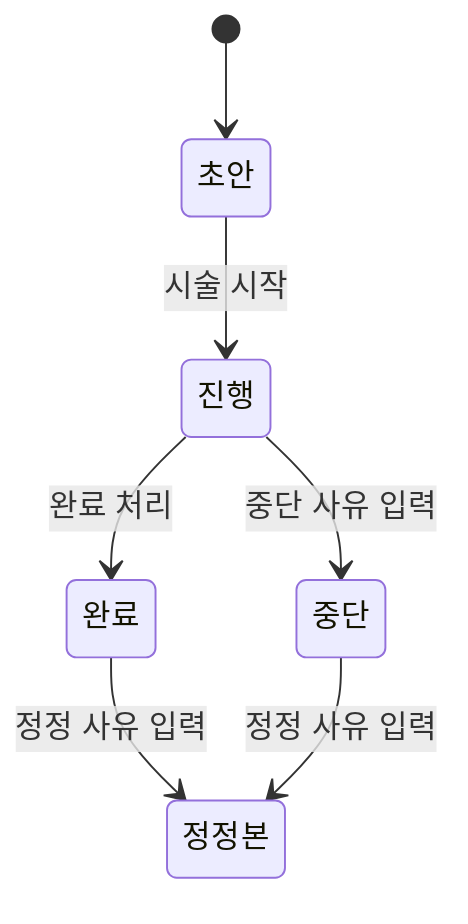
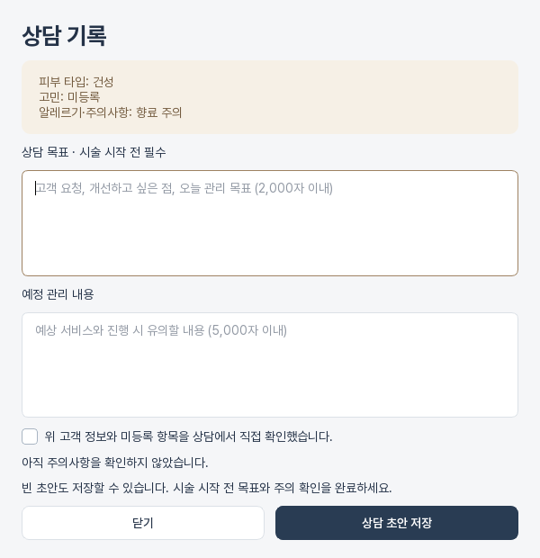

# 시술관리

시술관리는 고객별 상담, 주의사항, 동의 문서, 시술 기록과 상태 변경 이력을 연결합니다.

## 기록 찾기

- 왼쪽에서 고객을 이름·연락처로 검색합니다.
- 시술명, 담당자, 기록 검색과 날짜·상태 필터로 이력을 좁힙니다.
- 기록을 선택하면 상세 내용과 상태 변경 기능이 열립니다.

## 새 시술 기록

1. 고객을 선택하고 **새 기록**을 누릅니다.
2. 날짜, 시술명, 담당자, 부위, 사용 제품, 금액과 메모를 입력합니다.
3. 고객 주의사항과 상담 내용을 확인합니다.
4. **시술 기록 저장**을 누릅니다.

비슷한 시술을 반복한다면 **선택 기록 복사**로 새 기록을 만든 뒤 날짜와 변경된 내용을 확인해 저장합니다. 복사본은 원본과 별개의 새 기록입니다.

## 상태 변경

시술은 초안에서 시작해 진행, 완료 또는 중단 상태로 이동합니다. 완료·중단 기록은 내용을 직접 덮어쓰지 않고 **정정**으로 수정합니다. 정정 사유와 원본 버전이 함께 남아 변경 이력을 추적할 수 있습니다.

## 상담과 동의 문서

작성 중인 시술을 먼저 저장한 뒤 상담 화면을 엽니다. 상담에서는 고객 주의사항, 상담 초안과 확인 내용을 기록합니다. 문서 기능에서는 서식 버전을 선택해 미리 보고 발행하며, 서명·교부·철회 이벤트를 이력으로 남깁니다.

## 결제 초안

저장된 시술에서 결제 초안을 만들면 시술명, 금액, 담당자와 동의 상태가 당시 버전으로 고정됩니다. 실제 수납은 [장바구니·결제·회원권](sales-payments.md)에서 진행합니다.

!!! warning "완료 기록의 수정"
    완료·중단된 시술을 일반 저장으로 바꾸지 마세요. **정정 내용 저장**을 사용해야 이전 기록이 보존됩니다.
