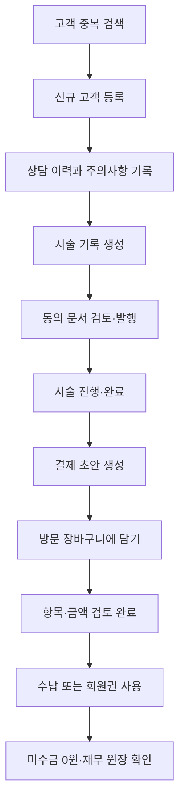

# 고객 등록부터 결제까지

신규 고객 한 명이 상담을 받고 시술한 뒤 결제하는 표준 흐름입니다.

## 전체 순서

## 1. 고객을 등록합니다

**고객·거래처**에서 전화번호를 먼저 검색합니다. 기존 고객이 없으면 상단의 **고객 등록**으로 빈 입력 화면을 연 뒤 정보를 작성하고, 입력 화면의 **고객 등록**을 눌러 저장합니다. 알레르기나 주의할 내용을 프로필 메모와 상담 이력의 목적에 맞게 구분해 기록합니다.

## 2. 상담과 시술을 기록합니다

고객 상세의 **시술관리 열기**로 이동해 **새 기록**을 만듭니다. 상담 내용과 고객 주의사항을 확인하고 시술명, 담당자, 금액을 저장합니다. 필요한 동의서를 미리 보고 발행한 뒤 서명·교부 상태를 기록합니다.

## 3. 시술 상태를 확정합니다

실제 업무에 맞춰 시술 시작과 완료를 기록합니다. 중단되었다면 사유를 남깁니다. 완료 후 잘못된 내용을 발견하면 일반 수정 대신 정정 기능을 사용합니다.

## 4. 결제 초안을 만듭니다

저장된 시술의 현재 명세로 결제 초안을 생성합니다. 이 초안에는 당시의 시술 내용과 동의 상태가 고정됩니다.

## 5. 방문 장바구니를 검토합니다

**매출·지출 → 결제 장바구니**에서 고객을 선택하고 **새 방문 시작**을 누릅니다. **선택 초안 담기**로 시술을 추가하고 필요하면 상품·회원권도 담습니다. 수량, 단가, 담당자와 총액을 확인한 뒤 **검토 완료**를 누릅니다.

## 6. 수납하고 결과를 확인합니다

**수납 기록 · 내역**에서 결제 수단별 금액을 입력합니다. 카드·이체는 식별번호를 함께 기록합니다. 회원권이 있다면 **고객 회원권 · 잔여 혜택**에서 사용할 수 있습니다.

완료 후 다음을 확인합니다.

- 장바구니의 남은 미수금이 예상과 같은가
- 수납 내역에 결제 수단과 금액이 한 번만 기록되었는가
- 매출·지출 화면에 확정 수입이 반영되었는가
- 상품 판매라면 재고가 줄었는가
- 회원권 판매라면 완납 후 혜택이 발급되었는가

!!! tip "나중에 받는 금액"
    일부 금액만 수납한 경우 방문을 새로 만들지 않습니다. 같은 방문의 **수납 기록 · 내역**에서 남은 미수금을 이어서 받습니다.
