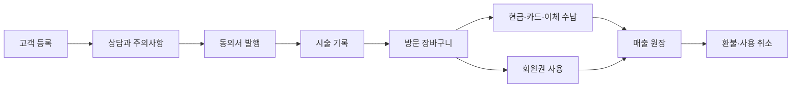
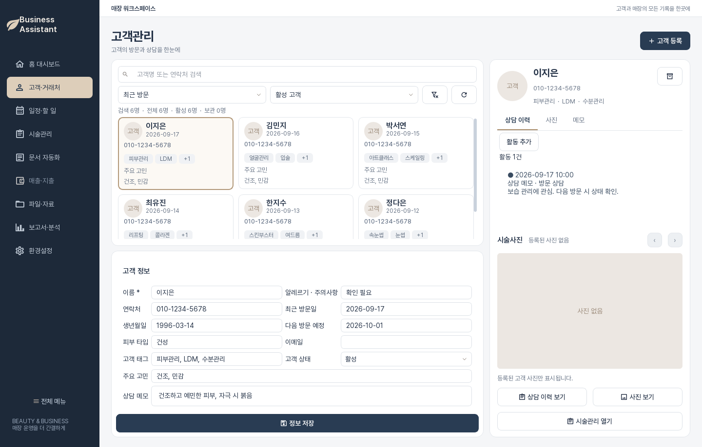

# 고객의 첫 방문부터 매장의 정산까지, 한 흐름으로

Business Assistant는 뷰티 매장의 고객·상담·시술 운영과 상품·회원권·결제 원장을 연결하는 데스크톱 프로그램입니다. 이 가이드는 처음 실행하는 사용자부터 운영자와 개발자까지 필요한 절차를 한곳에서 설명합니다.

[5분 안에 시작하기](guide/getting-started/quick-start.md){ .md-button .md-button--primary }
[고객에서 결제까지](guide/workflows/customer-to-payment.md){ .md-button }
[전체 기능 테스트 흐름](product/functional-test-flows.md){ .md-button }

## 필요한 설명으로 바로 이동하세요

[<strong>처음 사용하는 직원</strong>로그인, 화면 이동, 고객 등록과 시술 기록을 순서대로 익힙니다.](guide/getting-started/interface.md){ .guide-card }

[<strong>고객관리 담당자</strong>고객 검색, 정보 수정, 상담 이력과 사진 등록 방법을 확인합니다.](guide/user-guide/customers.md){ .guide-card }

[<strong>결제 담당자</strong>방문 장바구니, 복합 수납, 회원권과 환불 흐름을 확인합니다.](guide/user-guide/sales-payments.md){ .guide-card }

[<strong>매장 운영자</strong>Supabase, 권한, Storage와 운영 점검 기준을 확인합니다.](guide/admin/supabase.md){ .guide-card }

[<strong>개발자</strong>저장소 구조, Git worktree, 테스트와 배포 절차를 확인합니다.](guide/developer/architecture.md){ .guide-card }

[<strong>문제가 발생했나요?</strong>실행 실패, 403, 사진 503과 미확인 수납을 증상별로 해결합니다.](guide/troubleshooting.md){ .guide-card }

## 제품의 핵심 흐름

## 기능 상태를 읽는 방법

- 검증됨 자동 테스트와 기록된 범위가 통과한 기능입니다.
- 진행 중 코드가 존재하지만 실환경 확인이나 일부 업무 흐름이 남은 기능입니다.
- 계획됨 제품 계획에만 있고 현재 화면에서 사용할 수 없는 기능입니다.

!!! info "문서의 기준"
    이 가이드는 사용 방법을 설명합니다. 정확한 기능 ID, 인수 조건과 검증 상태는 [제품 계획 인덱스](product/README.md)를 기준으로 합니다. 화면 모형이나 버튼이 있다는 사실만으로 기능 전체가 완료된 것으로 보지 않습니다.

## 지금 확인할 수 있는 범위

현재 앱에는 고객·예약·시술·매출·회원권·재고·서비스·직원·정산·문서·파일·구성원·경영 화면이 연결돼 있습니다. 화면이 연결된 사실만으로 업무의 실환경 인수까지 끝난 것은 아닙니다. 수납·환불·마감, 사진/파일, 서명 증빙과 권한 변경은 테스트 조직에서 왕복 확인이 남아 있습니다. 최신 범위는 [메뉴 상태](guide/user-guide/menu-status.md), 기술 전환 및 제한은 [인수인계](product/handoff-2026-10-13.md)를 확인하세요.
