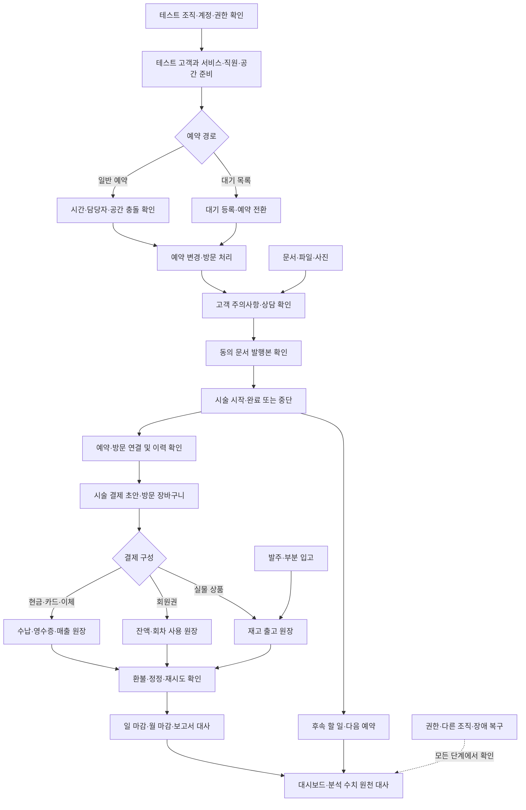

# 전체 기능 테스트 흐름

기준일: 2026-10-20. 이 문서는 테스트 조직에서 전체 업무 연결을 직접 인수할 때 사용하는 순서와 기대 결과를 정의한다. **아직 실행 결과가 아니며**, 체크 항목은 실제 확인 뒤에만 표시한다. 제품 기능 상태와 검증 범위는 [제품 계획 인덱스](README.md), [공통 품질 게이트](quality-gates.md), 각 메뉴 기능 문서를 따른다.

> 각 단계를 **어떻게 수행하고 기록하는지**(준비물, 입력값, 권한·장애 시험 방법, 결함 기록 형식)는 [기능 테스트 방법 가이드](functional-test-guide.md)를 본다.

## 시작 전 안전 조건

1. 로그인한 조직이 실제 운영 조직이 아닌 테스트 조직인지 확인한다. 사용자 CSV에서 조직 ID `cfe8bf07-798a-4194-8bdd-0cb1b3c8df57`, 조직명 `test`로 보고됐다. 이 값은 사용자가 제공한 집계 결과이며 현재 DB에 직접 접속해 재확인한 값은 아니다.
2. 테스트 전용 고객·예약·파일 이름에는 `[QA-YYYYMMDD]`처럼 식별 가능한 표식을 붙인다. 실제 고객에게 테스트 예약, 사진, 상담, 시술, 매출, 알림 이력을 추가하지 않는다.
3. 관리자와 일반 구성원 계정, 가능하면 접근할 수 없는 별도 조직 계정을 준비한다. 역할·구독·조직 검사는 메뉴 숨김만 보지 말고 실제 API 결과까지 확인한다.
4. 테스트 시작 전 주요 건수를 기록하고 테스트 뒤 변화분을 구분한다. 원장·감사 기록은 직접 지우지 않는다. 되돌릴 수 없는 고객 병합은 테스트 조직의 전용 고객 두 건으로만 확인한다.
5. 기존 테스트 초기화 SQL 초안은 현재 DB 집계와 전체 스키마에 맞춰 검증된 최종 시드가 아니다. 그대로 실행하지 않는다. 사진·파일 테스트는 실제 Storage 업로드가 필요하므로 SQL만으로 파일을 만들지 않는다.

## 전체 업무 흐름도

## 제공된 DB 상태 기준

2026-10-20에 받은 CSV는 건수와 상태 집계만 포함한다. 아래 수치는 사용자가 SQL Editor에서 조회해 전달한 값으로, 직접 DB 접속을 통한 독립 검증이나 개별 행의 업무 정확성 확인은 아니다.

| 영역 | 제공된 집계 | 테스트 준비에 주는 의미 |
| --- | --- | --- |
| 고객·예약 | 고객 16(활성 13, 비활성 1, VIP 2), 예약 3(confirmed 2, reserved 1) | 검색·상태·일정 화면의 기존 데이터는 있음. 새 QA 고객과 겹치지 않게 테스트할 것 |
| 예약 마스터 | 서비스 11, 직원 2, 자원 1, 대기 목록 0 | 기본 예약은 살펴볼 수 있음. 대기 목록 등록·전환은 테스트 전용 건이 필요 |
| 방문·시술 | 방문 8, 시술 기록 13(완료 6, 초안 4, 진행 1, 취소 1, legacy 1) | 여러 시술 상태가 있음. 예약·방문 연결 정확성은 별도 검증 필요 |
| 결제·회원권 | 장바구니 8(수집 1, 결제 5, 무효 2), 장바구니 행 9, 영수증 10, 지갑 2 | 결제 자료는 있음. 새 테스트는 전용 고객/방문에서 수행 |
| 상품·발주 | 상품 12(활성 실물 8, 활성 회원권 4), 재고 ledger 13, 공급처 1, 발주 1(ordered), 실물 재고 합계 233, 회원권 상품 수량 0 | 발주·재고·판매 자료가 있음. 회원권 상품의 상품 재고 수량 0은 혜택/잔액과 별도 개념인지 화면에서 확인 |
| 정산·업무 | 거래 24(활성 수입 14, 지출 10), 반복 지출 0, 할 일 12(열림 6, 진행 2, 완료 3, 취소 1) | 반복 지출 템플릿 흐름은 비어 있음. 감사 로그는 실제 동작으로 생성 여부 확인 |
| 문서·파일 | 문서 12(초안 6, 최종 5, 보관 1), 템플릿 4, 파일 자산 12, 고객 사진 13, 발행 문서 3, 문서 이벤트 3 | 기존 자료를 읽어볼 수 있음. 업로드·권한·철회는 QA 대상에서 새로 확인 |

감사 로그 0건은 테스트 준비 오류라고 단정하지 않는다. 이벤트가 발생하는 기능을 실행한 뒤 조직·행위자·이전/이후 값과 생성 여부를 확인한다. 대시보드와 분석의 수치는 실제 원장 또는 예약과 대조하며, 데이터가 없는 지표를 0 실적으로 오인 표시하지 않는지도 본다.

## 테스트 순서와 통과 조건

### 1. 로그인·조직·기본 마스터

- [ ] 관리자 로그인, 조직 선택, 권한/기능 정보 조회가 성공한다.
- [ ] 일반 구성원 계정으로 읽기·쓰기 가능한 메뉴 차이를 확인한다. 화면에서 숨겨도 API에 직접 요청했을 때 권한 없는 변경은 거부되어야 한다.
- [ ] 테스트 전용 고객 1명과 예약 서비스, 담당 직원, 근무시간, 공간/장비 조건을 확인하거나 테스트 조직에만 준비한다.
- [ ] 비활성 고객·직원·서비스는 새 예약 대상으로 선택되지 않는다. 다른 조직의 고객/직원/예약 ID를 바꿔 요청하면 데이터가 노출되거나 변경되지 않는다.
- [ ] 예정 예약이나 진행 방문이 있는 담당자를 비활성화하려 하면 거절되고, 연결 업무가 없을 때 중지/재활성화가 가능하다.
- [ ] 고객 보관·복원 후 검색과 예약 선택 결과를 확인한다. 병합은 되돌릴 수 없으므로 QA 전용 고객 2건으로만 실행하고 원본 관계·이력 보존을 확인한다.
- [ ] 서비스/직원/공간 설정 저장을 취소하면 변경이 없고, 저장 실패 시 입력 내용이 유지된다.

### 2. 고객 등록부터 예약 확정까지

- [ ] 테스트 고객을 등록하고 이름·연락처 검색, 상세 수정, 태그·주의사항 표시를 확인한다. 중복 클릭이나 재시도에도 고객이 중복 생성되지 않아야 한다.
- [ ] 사진을 업로드하고 썸네일/원본 표시, 권한 없는 계정의 접근 차단, 업로드 취소·실패 재시도를 확인한다. 삭제/휴지통 복원은 보관 상태와 영구 삭제의 차이를 확인한다.
- [ ] 담당자 근무시간·휴무와 서비스 소요시간·버퍼, 공간/장비 조건을 만족하는 시간을 조회해 예약한다.
- [ ] 같은 담당자의 겹치는 예약, 버퍼 시간 안의 예약, 필수 공간이 이미 점유된 예약은 거절되어야 한다. 시간 경계 직전/정각, 날짜 변경, 취소 후 슬롯 반환도 확인한다.
- [ ] 예약 시간·담당자 변경, 취소, 노쇼 사유를 기록하고 상세 이력에 행위자·시각·사유가 남는지 확인한다. 낡은 버전으로 저장하면 최신 내용을 덮어쓰지 않고 충돌 안내를 보여야 한다.
- [ ] 대기 목록이 비어 있는 상태에서 테스트 고객·서비스로 대기 등록 후 예약 전환을 한다. 같은 전환 요청 재시도는 예약을 추가로 만들지 않아야 한다. 전환된 행은 다시 전환할 수 없어야 한다.

### 3. 방문·상담·동의·시술

- [ ] 예약 고객을 방문 처리한다. 고객·예약·방문 ID가 서로 맞지 않으면 연결이 거부되어야 한다.
- [ ] 시술 전 확인에서 최신 고객 주의사항과 상담 확인자·시각·스냅샷을 확인한다. 기록 조회만으로 확인 상태나 시술 상태가 바뀌지 않아야 한다.
- [ ] 게시된 테스트 동의서 템플릿으로 발행본을 만들고, 발행 당시 버전/내용이 보존되는지 확인한다. 서명·교부·철회·증빙 상태가 서로 구분되어야 하며 철회한 문서는 유효 동의로 보이면 안 된다.
- [ ] 시술 기록을 시작해 완료하거나 중단한다. 중단 사유와 실제 수행 항목을 보존하고, 완료 후 수정은 원본과 정정 사유·이력을 남겨야 한다.
- [ ] 시술 기록에 예약과 방문을 명시적으로 연결·해제한다. 다른 고객의 방문 연결, 불일치하는 예약/방문 연결, 최종 기록의 제한 위반은 거부되어야 한다.
- [ ] 연결된 시술 결제 초안을 불러와 실제 시술 명세와 금액을 비교한다. 중복 불러오기·재시도에도 같은 시술 청구가 중복되지 않아야 한다. 자동으로 결제 완료나 시술 완료 상태를 만들지 않아야 한다.

### 4. 장바구니·수납·회원권·환불

- [ ] 방문 장바구니에 시술, 실물 상품, 할인, 회원권 적용액을 담고 서버 계산 합계와 화면 합계가 일치하는지 확인한다.
- [ ] 현금·카드·이체를 조합해 일부 수납 후 잔액, 나머지 수납 후 완납, 불완전한 수단/금액 입력 거절을 확인한다.
- [ ] 회원권 금액 또는 회차를 적용하고 사용 원장·남은 잔액/회차·영수증이 연결되는지 확인한다. 정지·만료·잔액 부족 회원권 사용은 거부되어야 한다.
- [ ] 관리자 권한으로 회원권 정지·재개·기간 연장을 수행하고 사유·버전·이력이 보존되는지 확인한다. 실패하거나 취소하면 잔액·만료일이 바뀌지 않아야 한다.
- [ ] 결제 응답이 시간 초과된 경우 새 결제를 만들지 말고 같은 작업 ID로 결과를 재확인한다. 같은 요청 재전송은 중복 영수증·매출을 만들지 않아야 한다.
- [ ] 테스트 영수증에서 상품 일부 환불·전체 환불과 회원권 사용 취소를 수행한다. 환불 원거래, 환불 금액, 재무 반대 기록, 재고/혜택 복원 수량을 서로 대조한다.
- [ ] 외부 카드 단말기·PG 취소는 실제 공급자 연동이 준비되지 않았다면 실행하지 않고 앱 내부 원장과 외부 승인 상태를 구분한다.

### 5. 상품·발주·재고

- [ ] 테스트 공급처와 실물 상품으로 발주를 만들고 일부 입고 후 나머지를 입고한다. 입고 누적량이 발주량을 넘지 않고 상품 재고와 stock ledger가 같은 수량으로 변해야 한다.
- [ ] 같은 입고 요청의 재시도는 재고를 두 번 늘리지 않아야 한다. 취소·잘못된 수량·비활성 상품은 적절히 거절되어야 한다.
- [ ] 판매 완료 시 재고 출고를 확인하고, 반품/환불 시 원거래 및 정책에 맞는 복원 ledger를 확인한다. 확정 ledger를 직접 수정하지 않는다.
- [ ] 회원권 상품의 `stock_quantity`와 고객 지갑의 금액/회차는 서로 다른 의미로 표시되는지 확인한다.

### 6. 정산·할 일·문서·파일·보고

- [ ] 테스트 전용 반복 지출 템플릿을 만들고 이번 달 지출을 등록한다. 같은 달 재실행은 두 번째 거래를 만들지 않아야 하며, 마감 월은 등록되지 않아야 한다. CSV 집계에서 템플릿은 0건이다.
- [ ] 수입·지출과 결제 수납·환불 원장을 대조하고 일 마감/월 마감 합계, 현금 시재, 미수 목록을 확인한다. 마감 월 변경이 차단되고 관리자 재오픈은 사유와 이력을 남겨야 한다.
- [ ] 고객·예약 연결 할 일을 등록해 담당자 배정, 기한/상태 변경, 완료·취소, 반복 생성 중복 방지를 확인한다. 실패 시 작성 내용을 잃지 않아야 한다.
- [ ] 문서 템플릿 초안→게시→새 버전 흐름에서 게시본 변경이 과거 발행본에 영향을 주지 않는지 확인한다. 파일 업로드·다운로드·폴더/태그 검색·보관/복원을 권한별로 확인한다.
- [ ] 구성원 관리에서 가입된 사용자의 역할 변경·권한 거부를 확인하고, 초대 메일이 구현되지 않은 상태를 성공한 것처럼 표시하지 않는지 본다. 플랫폼 구독 메뉴는 허용된 관리자에게만 보이는지 확인한다.
- [ ] 고객/매출 데이터 가져오기는 미리보기·잘못된 행 오류·중복 선택·취소를 확인하고, 내보내기는 현재 필터·권한·개인정보 범위를 따른다. 다운로드에 다른 조직 자료가 섞이지 않아야 한다.
- [ ] 실제 업무 이벤트를 만든 뒤 감사 기록에 행위자·조직·대상·시각이 남는지 확인하고 일반 구성원에게 관리자 전용 감사 화면/API가 허용되지 않는지 점검한다.
- [ ] 대시보드와 경영 화면의 예약·방문·매출·미수·재고 수치를 원본 목록에 대조한다. 일부 조회 실패는 0으로 둔갑하지 않고 실패 상태와 재시도 경로를 보여야 한다.

### 7. 공통 실패·권한·복구

- [ ] 읽기 전용 역할의 쓰기, 다른 조직 ID, 미허용 기능, 비활성 구성원 요청을 API에서 거부한다.
- [ ] 필수값 누락, 길이/금액/날짜 경계, 허용하지 않는 상태 전이와 오래된 버전 저장을 확인한다.
- [ ] 저장 직전 취소, 메뉴 이동, 고객 전환, 창 닫기에서 작성 중 입력을 저장/폐기/취소 중 선택할 수 있다. 실패 후 입력이 남아야 한다.
- [ ] 네트워크 단절·503·세션 만료·응답 시간 초과 후 읽기 요청은 재시도할 수 있어야 한다. 금전·예약·재고 쓰기는 자동으로 새 요청을 보내지 않고 동일 작업 결과 확인을 안내해야 한다.
- [ ] 로그/화면 오류에 비밀 키, 인증 토큰, 불필요한 고객 개인정보가 노출되지 않는지 확인한다.

## 결과 기록표

이 문서의 체크박스는 실행 전에 비워 둔다. 각 실행은 결과표에 날짜·앱/API 버전·테스트 조직·역할·결과 증거를 추가하고, 실패한 기능의 상태를 `verified`로 유지하지 않는다.

| 단계 | 실행 날짜 | 역할·테스트 조직 | 결과 | 증거/이슈 링크 |
| --- | --- | --- | --- | --- |
| 1. 로그인·조직·마스터 | 미실행 | 테스트 조직에서 수행 | pending | — |
| 2. 고객·예약 | 미실행 | 테스트 조직에서 수행 | pending | — |
| 3. 방문·상담·시술 | 미실행 | 테스트 조직에서 수행 | pending | — |
| 4. 수납·회원권·환불 | 미실행 | 테스트 조직에서 수행 | pending | — |
| 5. 발주·재고 | 미실행 | 테스트 조직에서 수행 | pending | — |
| 6. 정산·문서·파일·보고 | 미실행 | 테스트 조직에서 수행 | pending | — |
| 7. 권한·오류·복구 | 미실행 | 관리자·구성원·다른 조직 계정 | pending | — |

## 인수 완료 기준

- 정상 동선뿐 아니라 취소·실패·재시도·권한 거부·다른 조직 접근을 통과한다.
- 예약/방문/시술/결제/영수증/회원권/재고/재무의 원천 ID와 금액·수량이 연결된다.
- 재시도·동시 수정 뒤 중복 원장이나 입력 손실이 없고, 확정 데이터는 명시적 역거래·정정으로 보존된다.
- 실 Supabase, Windows/Tauri 앱, 외부 공급자 검증은 각각 실행 환경과 증거를 별도로 기록한다. 자동 테스트나 SQL 적용 보고만으로 실환경 인수 완료라고 표시하지 않는다.
- 기능 ID별 상태와 제한은 [개선·추가 작업 목록](backlog.md)과 [품질 게이트](quality-gates.md)를 함께 갱신한다.
