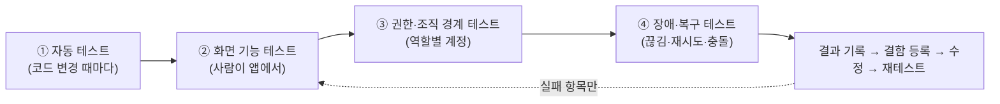

# 기능 테스트 방법 가이드

기준일: 2026-10-20. [전체 기능 테스트 흐름](functional-test-flows.md)이 **무엇을 어떤 순서로 확인하는지**(흐름도·체크리스트·합격 기준)라면, 이 문서는 **어떻게 실제로 수행하고 기록하는지**를 설명한다. 두 문서를 함께 열어 두고 진행한다.

!!! warning "먼저 지킬 것"
    - 운영 조직이 아닌 **테스트 조직**(현재 보고 기준 이름 `test`)에서만 진행한다. 로그인 직후 상단·설정 화면의 조직 이름을 확인한다.
    - 테스트로 만든 모든 이름에 `[QA-날짜]` 표식을 붙인다. 예: `[QA-1020] 김테스트`, 전화번호 `010-0000-0001`.
    - 고객 병합·영구 삭제·마감은 되돌릴 수 없다. 테스트 전용 고객/월로만 한다.
    - 원장·감사 기록은 직접 지우지 않는다. 틀린 값은 화면의 정정·환불·취소 기능으로 바로잡는다.
    - SQL 시드(`scripts/db-tests/seed-functional-test-data.sql`)는 **최종본이 아니다**. 실행 전에 `inspect-functional-test-data.sql`로 현재 건수를 확인하고, 시드 안의 조직 UUID를 바꾼 뒤 필요할 때만 쓴다. 화면에서 직접 만드는 편이 더 안전하다.

## 1. 전체 그림 — 테스트는 4겹으로 한다



| 겹 | 누가 | 무엇을 | 도구 |
| --- | --- | --- | --- |
| ① 자동 | 개발자·AI | 단위·계약·격리 DB 테스트 | 아래 2장 명령 |
| ② 화면 | 업무 담당자 | 업무 흐름 처음부터 끝까지 | 앱 + 이 문서 4장 |
| ③ 권한 | 원장·개발자 | owner/admin/member/타 조직 차이 | 계정 4개 + 5장 |
| ④ 복구 | 개발자 | 네트워크 끊김·중복 요청·충돌 | 6장 |

## 2. 시작 전 점검 (10분)

### 2-1. 자동 테스트가 통과하는지

저장소 루트에서 실행한다. 하나라도 실패하면 화면 테스트를 시작하지 말고 먼저 알린다.

```powershell
pnpm --filter @business-assistant/api test
pnpm --filter @business-assistant/desktop-react test
pnpm --filter @business-assistant/react-ui test
npm test --prefix scripts/db-tests
```

기대 결과: 모두 `failed` 0. (2026-10-20 점검에서 실패했던 2건은 같은 날 수정했다. 변경 이력 참고.)

### 2-2. SQL이 순서대로 적용됐는지

Supabase SQL Editor에서 `migrations/` 번호를 마지막 번호(현재 **065**)까지 순서대로 적용했는지 확인한다. 적용 순서는 **SQL → API 재시작 → 앱 갱신**이다. 어디까지 적용했는지 모르면 `scripts/db-tests/inspect-functional-test-data.sql`(읽기 전용)을 실행해 테이블 존재·건수를 본다. 없는 테이블이 있으면 그 번호부터 적용한다.

### 2-3. API·앱 실행

```powershell
.\run-app.cmd
```

- API 상태 확인: 브라우저에서 `http://127.0.0.1:8000/api/v1/health`가 `{"status":"ok"}`인지 본다.
- Windows 스마트 앱 컨트롤 등으로 앱이 막히면(`os error 4551`) 보안 설정은 건드리지 말고 알린다. 대신 서명된 설치본을 쓰거나 개발 미리보기(`scripts/run-react-web.ps1`)로 화면만 확인한다.

### 2-4. 계정·자료 준비표

| 준비물 | 방법 | 확인 |
| --- | --- | --- |
| owner 계정 | 테스트 조직 소유자 | 전체 메뉴·구성원·감사 로그 보임 |
| admin 계정 | 구성원 화면에서 역할 `admin` | 마스터 수정 가능 |
| member 계정 | 구성원 화면에서 역할 `member` | 조회·일부 등록만 |
| 타 조직 계정 | 다른 조직 사용자 | 테스트 조직 자료가 안 보임 |
| 마스터 | 서비스 2개, 직원 2명, 공간·장비 각 1개 | 이름에 `[QA-…]` |
| 상품 | 일반 상품 1(재고 10), 회원권 상품 1 | 재고 수치 기록 |

시작 전 건수(고객·예약·방문·수납·재고 합계)를 [결과 기록표](#8-결과-기록-방법)의 "시작 값" 칸에 적는다.

## 3. 한 화면을 테스트하는 기본 절차

모든 화면에서 같은 순서를 쓴다.

1. **정상 1건**: 가장 흔한 입력으로 저장 → 목록에 나타나는지 → 새로고침 후에도 남는지.
2. **경계값**: 빈 값, 최대 길이, 음수·0, 과거 날짜, 같은 이름 중복.
3. **수정·되돌리기**: 수정 후 이력/버전이 남는지, 보관·삭제 후 복원되는지.
4. **같은 걸 두 번**: 저장 버튼을 빠르게 두 번 눌러 중복 생성이 없는지(멱등).
5. **다른 곳에서 먼저 바꾼 경우**: 앱을 두 창으로 열어 한쪽에서 수정 → 다른 쪽 저장 시 "다른 곳에서 먼저 수정" 안내가 나오는지(버전 충돌).
6. **이탈 보호**: 입력 중 메뉴를 옮기면 "저장하지 않은 변경" 확인이 뜨는지.
7. **읽기 전용 역할**: member 계정에서 쓰기 버튼이 막히거나 거절 안내가 나오는지.

## 4. 단계별 수행 방법

각 단계의 체크 항목은 [테스트 흐름](functional-test-flows.md)의 같은 번호 단계를 쓴다. 아래는 **무엇을 입력하고 무엇을 봐야 하는지**다. 화면 문구는 버전에 따라 조금 다를 수 있으니 가장 가까운 버튼을 쓰고, 다르면 결과표 메모에 적는다.

### 단계 1. 로그인·조직·마스터

| 순서 | 할 일 | 기대 결과 |
| --- | --- | --- |
| 1 | owner로 로그인 → 조직 이름 확인 | `test` 조직, 구독 메뉴는 플랫폼 관리자만 |
| 2 | 틀린 비밀번호 5회 | 일시 잠금·균일한 실패 문구 |
| 3 | 전체 메뉴 → 서비스에서 `[QA] 기본 케어` 등록(60분, 가격 50,000) | 목록에 표시, 소요 시간 반영 |
| 4 | 직원 2명 등록·근무시간 설정, 서비스별 담당 가능 직원 지정 | 지정하지 않은 직원은 예약 시 선택 불가 |
| 5 | 공간·장비 등록, 서비스 필수 공간/장비 지정 | 예약 가능 시간에 반영 |

### 단계 2. 고객·예약

| 순서 | 할 일 | 기대 결과 |
| --- | --- | --- |
| 1 | 고객관리 → 신규 `[QA-1020] 김테스트` | 저장 후 검색에 나옴. 동일 전화번호 재등록 시 중복 안내 |
| 2 | 마케팅 수신 동의 체크·해제 | 동의 시각이 서버에 남음(해제 시 표시 변경) |
| 3 | 예약 → 내일 10:00 예약 등록 | 달력에 표시 |
| 4 | 같은 직원·같은 시간에 두 번째 예약 | **충돌 거절** 안내 |
| 5 | 직원 휴무일에 예약 | 거절 |
| 6 | 예약을 끌어서 다른 시간으로 이동 | 이동됨, 충돌 시 거절 |
| 7 | 예약 상태 변경(확정→노쇼, 사유 입력) | 상태 변경 이력에 사유·시각 |
| 8 | 가능한 시간이 없는 날 대기 목록 등록 → 빈 시간이 생긴 뒤 **예약으로 전환** | 대기 건이 `booked`, 같은 요청 재시도해도 예약 1건 |
| 9 | 고객 상세의 최근 방문·다음 예약 요약 | 실제 방문/예약 기준 수치 |

### 단계 3. 방문·상담·동의·시술

| 순서 | 할 일 | 기대 결과 |
| --- | --- | --- |
| 1 | 예약에서 방문 처리 → 시술 화면으로 진입 | 고객·예약이 연결된 채 열림 |
| 2 | 고객 주의사항(알레르기 등) 입력 후 시술 전 확인 | 시술 전 최신 주의사항·상담 스냅샷 표시 |
| 3 | 문서 서식 게시 → 고객에게 발행 → 서명(마우스) | 발행본 불변, 서명 증빙(시각·해시) 표시, PDF 저장 |
| 4 | 서명 철회 | 철회 이력이 남고 이전 서명은 보존 |
| 5 | 시술 시작 → 소모품 입력 → 완료 | 상태 전이, 소모품 재고 차감 |
| 6 | 시술 중단·정정(사유 필수) | 원본 스냅샷 보존, 정정 이력 |
| 7 | 시술 전/후 사진 업로드 | 미리보기·진행률·취소 동작, 삭제 시 휴지통 → 복원 |

### 단계 4. 장바구니·수납·회원권·환불

| 순서 | 할 일 | 기대 결과 |
| --- | --- | --- |
| 1 | 매출 → 방문 장바구니에서 시술 초안 가져오기 | 방문·시술과 금액 일치 |
| 2 | 정액/비율 할인 적용 | 합계 재계산, 서버 합계와 동일 |
| 3 | 현금 20,000 + 카드 30,000 복합 수납 | 합계 일치, 미수 0 |
| 4 | 수납 중 네트워크를 끊고 재시도(6장) | 중복 수납 없음, 재시작 후 복구 안내 |
| 5 | 회원권 상품 판매 → 시술에서 회차/금액 차감 | 잔액·이력 일치 |
| 6 | 실물 상품 판매 | 재고 -판매수량, 재고 원장 1건 |
| 7 | 영수증 PDF 저장 | 금액·수단 일치 |
| 8 | 환불(전체/부분) | 반대 원장 생성, 재고·회원권 복원, 초과 환불 거절 |

### 단계 5. 상품·발주·재고

| 순서 | 할 일 | 기대 결과 |
| --- | --- | --- |
| 1 | 안전재고 설정 후 재고를 그 아래로 | 홈 재고 부족 표시 |
| 2 | 공급처 등록 → 발주서 작성(2품목) → 상태 변경 | 초안→발주 |
| 3 | 일부만 입고 → 나머지 입고 | 잔량 감소, 재고·원장 증가, 초과 입고 거절 |
| 4 | 실사로 재고 조정 | 조정 원장 생성 |

### 단계 6. 정산·할 일·문서·파일·보고

| 순서 | 할 일 | 기대 결과 |
| --- | --- | --- |
| 1 | 정산 → 지출 등록, 반복 지출 만들고 "이 달 반복 지출 등록" 두 번 | 한 번만 등록, 두 번째는 건너뜀 |
| 2 | 일 마감(시재 입력) | 그 날짜 수납 잠금, 차액 표시 |
| 3 | 월 마감 → 마감 월에 지출 추가 시도 | **거절**, 재오픈 후 가능 |
| 4 | 할 일 등록(담당자·기한·반복·체크리스트·고객 연결) → 완료 | 완료자 이름·시각 표시, 반복은 다음 회차 생성 |
| 5 | 파일 업로드·폴더·태그·다운로드·보관 | 보관 파일은 직접 접근 불가(SEC-12) |
| 6 | 경영 → 기간 비교·내보내기, 세무용 내보내기 | 수납 합계와 대조해 일치 |
| 7 | 홈 지표(오늘 매출·미수·재고) | 매출 내역과 같은 값 |

### 단계 7. 공통 실패·권한·복구

6장과 5장을 따른다.

## 5. 권한·조직 경계 테스트 방법

화면에서 버튼이 안 보인다고 서버가 막는 것은 아니다. **API가 실제로 거절하는지**까지 본다.

### 5-1. 화면에서 (기본)

| 계정 | 시도 | 기대 |
| --- | --- | --- |
| member | 서비스·직원·마감·구성원 수정, 고객 병합, 감사 로그 | 버튼 없음 또는 403 안내 |
| admin | 구성원 역할 변경, 마감, 반복 지출 | 허용(소유자 전용 제외) |
| 타 조직 | 테스트 조직 고객 검색 | 결과 없음 |

### 5-2. API 직접 호출 (개발자)

member 계정으로 로그인한 앱의 토큰을 개발자 도구 대신 로그인 응답에서 얻어 쓴다. 토큰은 **문서·채팅·저장소에 붙이지 않는다.**

```powershell
$h = @{ Authorization = "Bearer $env:TEST_MEMBER_TOKEN" }
$org = "<테스트 조직 ID>"
# 읽기: 200 이어야 함
Invoke-RestMethod -Headers $h "http://127.0.0.1:8000/api/v1/organizations/$org/tasks"
# 관리자 전용 쓰기: 403 이어야 함 (예: 반복 지출 생성)
Invoke-RestMethod -Method Post -Headers $h -ContentType 'application/json' `
  -Body '{"name":"[QA] 권한시험","amount":1000,"category":"기타","day_of_month":1}' `
  "http://127.0.0.1:8000/api/v1/organizations/$org/finance-recurring-expenses"
# 다른 조직 ID로 같은 요청: 403 또는 404 이어야 함
```

기대: 읽기 200, 관리자 전용 쓰기 403, 타 조직 ID 403/404. 200이 나오면 **심각 결함**이다. 토큰 환경변수는 테스트 후 지운다.

## 6. 장애·복구 테스트 방법

| 상황 | 만드는 법 | 기대 |
| --- | --- | --- |
| 저장 중 네트워크 끊김 | 저장 직후 Wi-Fi 끄기 → 결과 확인 → 다시 켬 | 결과 "확인 불가" 안내, 다시 열었을 때 중복 없이 1건 |
| 수납 재시도 | 수납 직후 앱 종료 → 재실행 | 미확인 수납 복구 안내, 이중 수납 없음 |
| 동시 수정 | 앱 2창에서 같은 고객 수정·저장 | 늦은 쪽에 "먼저 수정됨" |
| 같은 시간 예약 동시 생성 | 2창에서 거의 동시에 같은 슬롯 예약 | 1건만 성공 |
| API 서버 중지 | API 종료 후 앱 조작 | 오류 안내·재시도 버튼, 데이터 손실 없음 |
| 로그인 만료 | 오래 방치 후 조작 | 재로그인 유도, 입력 보호 |
| 입력 중 이탈 | 입력 후 다른 메뉴/창 닫기 | 저장하지 않은 변경 확인 |

## 7. 심각도와 판정

| 등급 | 의미 | 예 | 조치 |
| --- | --- | --- | --- |
| S1 | 데이터 손실·금액 불일치·권한 우회 | 환불 후 재고 미복원, member가 마감 | 즉시 중단·보고 |
| S2 | 주요 흐름 막힘 | 예약 저장 불가, 수납 불가 | 해당 단계 보류 |
| S3 | 우회 가능한 오류 | 문구 오류, 목록 새로고침 필요 | 모아서 수정 |
| S4 | 개선 제안 | 위치·편의 | 백로그 |

단계 **합격** = S1·S2 없음 + 체크 항목 전부 통과. 기능 전체를 `done`으로 바꾸는 근거는 이 표의 통과 기록뿐이다.

## 8. 결과 기록 방법

[테스트 흐름](functional-test-flows.md)의 결과표를 갱신하고, 결함마다 아래 형식으로 남긴다. 스크린샷에는 고객 실명·전화번호가 보이지 않게 한다.

```text
[단계-번호] 요약 한 줄
등급: S1~S4        날짜/계정(역할): 2026-10-20 / member
수행: 1) … 2) …
기대: …            실제: …
증거: 화면 캡처 파일명, 해당 시각, (API 호출이면 응답 상태 코드)
```

시작 값/종료 값(건수) 표 예시:

| 항목 | 시작 | 종료 | 변화 | 기대 변화 | 일치 |
| --- | --- | --- | --- | --- | --- |
| 고객 | | | | +1 | |
| 예약 | | | | +2 | |
| 수납 합계 | | | | +50,000 | |
| 재고(상품1) | | | | -1 | |

## 9. 테스트 후 정리

- 테스트 데이터는 지우지 않고 `[QA]` 표식으로 남겨 두어도 된다. 운영 전에 별도 조직으로 분리하거나 보관 처리한다.
- 임시 토큰·환경변수는 삭제한다. 시드 SQL을 실행했다면 실행 시각과 조직 ID를 결과표에 적는다.
- 실패 항목은 수정 후 **그 단계만** 다시 수행하고, 통과 시 결과표와 [백로그](backlog.md) 상태를 갱신한다.

## 10. 테스트가 아직 줄 수 없는 것

외부 서비스(문자·알림톡·네이버 예약·PG·현금영수증·초대 메일), 서명된 설치본의 자동 업데이트, 운영 HTTPS 배포는 결정·계약 후 별도 인수한다. [보류 항목](pending-decisions-2026-10-14.md) 참고.
