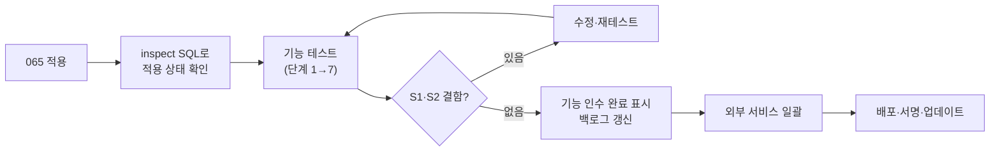

# 프로젝트 현황 점검 — 2026-10-20

이 문서는 2026-10-14 이후 여러 작업 세션이 추가된 뒤의 **전체 상태를 다시 점검한 결과**다. 코드·테스트는 이번에 직접 실행해 확인했고, 실 Supabase·설치본은 확인하지 못했다(아래 "확인 수준" 참고).

## 1. 점검 결과 한눈에

| 영역 | 상태 | 근거 |
| --- | --- | --- |
| 코드 기능(Node API·React·Tauri) | 대부분 구현 | 백로그의 P1~P3 중 외부 서비스·정책 결정 항목을 제외하면 구현 |
| 자동 테스트 | **전체 통과** (수정 후) | API 933 · React 1186 · react-ui 16 · 격리 DB 묶음 전체 통과 · API/데스크톱 빌드 성공 |
| SQL(001~065) | 문서·테스트 정리됨 | 059~064는 사용자 적용 보고, **065 신규(미적용)** |
| 실환경 인수 | **거의 미수행** | 046~064 실 Supabase·앱 창 업무 왕복 미확인 |
| 배포·서명·업데이트 | 미수행 | 사용자가 "나중에"로 보류 |
| 외부 서비스 | 미연동 | 문자·알림톡·네이버 예약·PG·현금영수증·초대 메일 |

### 확인 수준 (표기 기준)

- **직접 확인**: 이번 점검에서 명령을 실행해 결과를 봄(자동 테스트·빌드).
- **사용자 보고**: SQL 적용 완료 같은 보고. 원격 DB를 독립 조회하지 않음.
- **미확인**: 실제 Supabase·Windows 앱 창·설치본에서 확인하지 않음.

## 2. 이번 점검에서 찾아 고친 결함 2건

다른 세션이 기능을 추가한 뒤 자동 테스트가 실제로 깨져 있었다.

| 결함 | 원인 | 조치 |
| --- | --- | --- |
| **고객 병합이 예약 대기 목록을 옮기지 않음** (실제 데이터 결함, S1급) | 044의 `merge_customers`는 056(대기 목록) 이전에 만들어져 이동 목록에 없었다. 병합으로 보조 고객이 삭제되면 대기 목록이 연쇄 삭제된다 | `065_merge_customers_waitlist.sql` 추가(함수 재정의, 044는 불변). 계약 테스트가 최신 함수를 검사하도록 보강 |
| 파일 미리보기 테스트 7건 실패 | FILE-11이 파일 화면에서 폴더 목록도 불러오도록 바뀌었는데 이 테스트의 가짜 API가 폴더 응답을 주지 않음 | 테스트에 빈 폴더 목록 응답 추가(앱 코드는 정상) |

**065는 아직 Supabase에 적용되지 않았다.** 적용 전까지 운영 데이터에서 고객 병합을 하지 않는다. 적용 순서는 저장소 `migrations/README.md`의 065 항목을 따른다.

## 3. 완성된 부분 (코드·자동 테스트 기준)

| 영역 | 완성 범위 |
| --- | --- |
| 기반 | 조직·권한(owner/admin/member)·로그인 보호·감사 로그·세션 복원·유휴 잠금·개인정보 가림 |
| 고객 | 등록·수정·보관·태그·중복 병합·가져오기/내보내기·사진(휴지통 복원)·수신 동의·주요 프로필·방문/다음 예약 요약 |
| 예약 | 달력(일·주·직원별)·가용 시간 계산·자원 충돌·드래그 이동·담당자 필터·메모·노쇼 사유·상태 이력·대기 목록과 예약 전환 |
| 시술 | 상담·주의사항·시술 상태/정정 이력·소모품 차감·프로토콜 템플릿·사진 전/후·예약/방문 연결·시술 전 확인 |
| 문서·파일 | 서식 버전·발행·서명 증빙·PDF·자동 채움 항목·파일 미리보기·폴더/태그·보관 파일 직접 접근 차단 |
| 매출·회원권 | 방문 장바구니·할인·복합 수납·환불·회원권 차감/정지/연장·영수증 PDF·일/월 마감·미수금 |
| 재고·발주 | 안전재고·실사·조정·공급처·발주·부분 입고·서비스별 담당 직원 |
| 정산·경영 | 수입/지출·반복 지출·세무 내보내기·기간 비교·담당자 막대 차트·홈 월 대비 |
| 할 일 | 라벨·체크리스트·반복·담당자·완료자 기록·일괄 완료·고객/예약 연결·기한 알림 |
| 운영 | CI·릴리스 구성·Native HTTP 제한 시간·데스크톱 알림·입력 이탈 보호·업데이트 확인 UI |

## 4. 미비한 부분

### 4-1. 검증 미비 (가장 큰 위험)

| 항목 | 내용 | 대응 |
| --- | --- | --- |
| 실 Supabase 왕복 | 046~065 기능 전부 격리 DB(PGlite)·모의 API로만 검증. RLS·권한·동시성 실환경 미확인 | [기능 테스트 가이드](functional-test-guide.md) 수행 |
| 앱 창 업무 흐름 | 개발 PC가 스마트 앱 컨트롤로 앱 실행을 막음. 화면 수동 확인 미수행 | 서명된 설치본 또는 다른 PC |
| 고객 병합 DB 테스트 | 격리 DB 병합 테스트가 없고 계약(소스 문자열) 테스트만 있다. 이번 결함도 그래서 늦게 드러남 | 개발 작업(아래 5-2) |
| 설치본·서명·업데이트 | 첫 설치/업데이트 시험 없음 | 배포 단계 |

### 4-2. 기능 미비 (코드 작업)

| ID | 미비 내용 |
| --- | --- |
| INV-11 | 로트·유통기한, 상품 카테고리·이미지, 바코드 |
| LAB-10 | 원가·인건비 반영 최종 손익(원가·수당 기록 없음) |
| TEAM-11 | 수당·성과, 휴무 신청/승인, 직원 계정 연결 |
| APT-15~20 | 빈 시간 추천 고도화, 반복 예약, 셀프 예약, 대기 제안 정책, 다지점 |
| WAL-11·ADM-11 | 회원권 양도, 플랜 셀프서비스·청구 이력 |
| HOME-03 | 위젯 순서·표시 설정(고정 격자 계약과 충돌해 보류) |
| FILE-11 | 공유 링크·용량 한도·버전 이력 |
| CRM-14 | 영구 삭제 화면 |

### 4-3. 외부 서비스·정책 결정 대기

[보류 항목과 결정 사항](pending-decisions-2026-10-14.md)의 D-01~D-19를 따른다. 문자·알림톡, 네이버 예약, SNS 게시, PG·현금영수증, 초대 메일, 저장소 보관 기간, 카드 정산 대사가 여기에 속한다. 사용자가 "외부 서비스는 나중에 몰아서"로 정했으므로 지금 진행하지 않는다.

## 5. 작업이 필요한 내용 (누가 무엇을)

### 5-1. 사용자(원장/운영자)가 할 일 — 순서대로

1. **SQL 065 적용**: Supabase SQL Editor에서 `migrations/065_merge_customers_waitlist.sql` 실행 → API 재시작 → 앱 갱신. (함수 교체뿐이라 재실행해도 안전)
2. 059~064 적용 상태 확인: `scripts/db-tests/inspect-functional-test-data.sql`을 실행해 대기 목록·구매 발주·직원 프로필 등 테이블 존재를 확인한다.
3. **기능 테스트 수행**: [기능 테스트 가이드](functional-test-guide.md)와 [테스트 흐름](functional-test-flows.md)의 단계 1→7. 결과표에 기록한다.
4. 역할별 계정 4개(owner·admin·member·타 조직) 준비.
5. 앱 실행 차단 해결: 서명된 설치본을 쓰거나 별도 PC에서 실행(보안 설정은 사용자 판단).
6. 결과에서 나온 결함을 개발 세션에 전달(가이드 8장 형식).

### 5-2. 개발 작업(다음 세션 후보)

| 우선 | 작업 | 이유 |
| --- | --- | --- |
| 1 | 고객 병합 격리 DB 테스트 추가(`ops-0NN`) — 모든 `customer_id` 참조 테이블 이동·삭제 확인 | 이번 결함 재발 방지. 현재는 소스 문자열 검사뿐 |
| 2 | 화면 테스트에서 나온 결함 수정 | 실환경 인수의 직접 산출물 |
| 3 | 화면별 사용 가이드(Artifact)를 최신 기능으로 갱신 | 대기 목록·발주·직원 프로필·예약 이력 등 누락 |
| 4 | INV-11 로트·유통기한 설계 | 뷰티 재고에 필요, 정책 일부 선결정 필요 |
| 5 | 원가·수당 기록 설계(LAB-10·TEAM-11 선행) | 최종 손익 계산의 전제 |

### 5-3. 정책 결정이 필요한 것

사진·파일 보관 기간(D-10), 영수증 첨부 저장소(D-06), 카드 정산 대사 자료(D-19), 문자 공급자(D-01). 상세 선택지·권장안은 보류 항목 문서에 있다.

### 5-4. 배포 단계(나중)

HTTPS API 배포, 별도 관리자 API, 코드 서명 인증서, 자동 업데이트 시험, 새 PC 설치·복구. 사용자 요청에 따라 후순위다.

## 6. 권장 진행 순서

## 7. 관련 문서

[기능 테스트 가이드](functional-test-guide.md) · [전체 기능 테스트 흐름](functional-test-flows.md) · [백로그](backlog.md) · [보류 항목](pending-decisions-2026-10-14.md) · [변경 이력](changelog.md)
