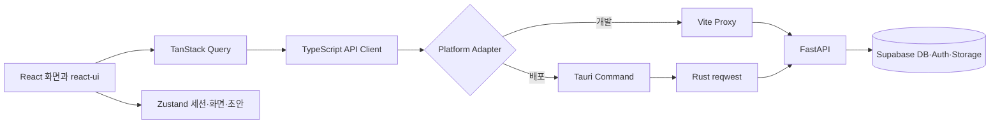

# React/Tauri 데스크톱 전환 설계

상태: 사용자 설계 승인, 1차 구현 계획 작성 완료  
기준일: 2026-10-12  
추적 ID: UI-002  
참고 프로젝트: `D:\LCID`

## 1. 결정과 목표

기존 FastAPI·Supabase 백엔드와 데이터 계약은 유지하고, 새 데스크톱 클라이언트를 React 19, TypeScript, Vite, Tauri 2로 만든다. 현재 `apps/desktop` PySide6 앱은 새 앱이 기능 동등성과 Windows 실환경 인수를 통과할 때까지 정상 동작 가능한 백업으로 보존한다.

새 앱은 LCID의 조밀한 업무 화면, 상단 메뉴, 데이터 표, 팝업, 버튼·선택 상자·마우스 오버 동작을 참고한다. 색은 기존 제품 방향인 밝은 베이지·아이보리와 로즈 브라운을 사용한다. LCID 소스에 런타임 의존하지 않고 필요한 공통 요소를 이 저장소에 맞게 이식한다.

이식한 코드와 자산은 원본 파일·패키지·버전을 추적할 수 있는 출처 목록을 남기고 원본의 라이선스·고지 파일을 보존한다. 라이선스가 확인되지 않거나 배포 조건이 제품 배포와 맞지 않는 코드는 동작만 참고해 새로 구현한다.

성공 기준은 다음과 같다.

- 작은 한글과 숫자도 선명하며, 100%, 125%, 150% Windows 배율에서 정보가 잘리거나 겹치지 않는다.
- 좌측 고정 메뉴 대신 상단 업무 메뉴와 보조 메뉴 팝업을 사용한다.
- 고객관리 1차 수직 기능이 로그인부터 조회·수정·사진·활동·오류 복구까지 실제 API로 동작한다.
- 사용자가 작성 중인 입력은 메뉴 이동, 고객 전환, 창 닫기, 통신 실패에서 보호된다.
- 조직·역할·기능 권한은 화면과 서버 양쪽에서 검사하며 다른 조직 데이터 접근을 허용하지 않는다.
- 기존 PySide6 기능을 제거하지 않은 상태로 React 앱을 병행 실행하고 비교할 수 있다.

## 2. 범위와 제외 범위

### 이번 전환에 포함

- React/Tauri 앱과 공통 React UI 패키지의 구조
- 인증, 조직 선택, 세션 복원, 로그아웃
- 상단 메뉴 기반 앱 셸과 공통 상태·팝업·알림
- 첫 수직 기능인 대시보드와 고객관리
- 고객 검색·목록·등록·수정·활동·사진 조회와 등록
- 공통 데이터 표, 검색·필터, 선택 상자, 날짜·시간 입력, 파일 선택
- LCID에서 확인한 제품 적합 기능의 이식 목록과 단계별 도입 기준
- 브라우저 개발 모드와 Tauri 배포 모드의 전송 계층
- 기존 PySide6와 기능 동등성 비교 및 최종 전환 기준

### 이번 전환에 포함하지 않음

- FastAPI를 다른 언어 또는 프레임워크로 교체
- Supabase 스키마 전체 재설계
- 미구현 제품 기능을 화면 모형만으로 완료 처리
- LCID의 통화·통관·광고처럼 뷰티 매장 운영과 직접 관련 없는 업무 복제
- 첫 수직 기능 단계에서 PySide6 삭제
- 첫 수직 기능 단계에서 전체 메뉴를 동시에 React로 재작성

## 3. 저장소 구조

```text
business-assistant/
├─ apps/
│  ├─ desktop/              # 기존 PySide6 앱, 안정화 전까지 보존
│  ├─ desktop-react/        # 새 React/Tauri 앱
│  │  ├─ src/
│  │  ├─ src-tauri/
│  │  ├─ public/
│  │  └─ package.json
│  └─ server/               # 기존 FastAPI 서버
├─ packages/
│  ├─ common/               # 기존 Python 공통 패키지
│  └─ react-ui/             # 새 공통 React UI와 디자인 토큰
├─ migrations/              # 기존 SQL 마이그레이션
├─ package.json             # JavaScript 작업공간 명령
└─ pnpm-workspace.yaml
```

패키지 관리는 현재 설치된 pnpm 11 계열과 Corepack을 기준으로 한다. Python의 uv 작업공간과 JavaScript의 pnpm 작업공간은 서로의 잠금 파일과 실행 환경을 침범하지 않는다.

## 4. 전체 구조와 데이터 흐름



화면은 HTTP 구현을 직접 알지 않는다. TypeScript API 클라이언트는 인증 헤더, 응답 검증, 오류 정규화와 재인증만 담당한다. 브라우저 개발 모드는 Vite 프록시를 통해 기존 FastAPI에 연결하고, 설치 앱은 Tauri 명령을 호출해 Rust `reqwest`로 FastAPI와 통신한다. 이 구조는 제품 서버에 광범위한 CORS 허용을 추가하지 않고도 브라우저 개발과 설치 앱을 모두 지원한다.

FastAPI API와 Supabase RLS가 최종 권한 경계다. React에서 숨긴 메뉴나 버튼은 사용성 보조일 뿐 보안 경계가 아니다.

## 5. 프런트엔드 경계

### `app`

앱 시작, QueryClient, 서비스 조립, 전역 오류 경계, 세션 복원, 조직 선택, 라우팅을 담당한다. 기능 화면의 업무 규칙을 포함하지 않는다.

### `api`

기존 FastAPI 요청·응답을 TypeScript 타입과 런타임 검증으로 감싼다. 모든 오류는 상태 코드, 사용자 메시지, 재시도 가능 여부, 요청 식별자를 가진 공통 오류로 변환한다. 인증 갱신이 동시에 여러 번 발생하면 하나의 갱신 요청만 실행한다.

### `platform`

브라우저와 Tauri 차이를 감춘다. HTTP, 파일 선택, 파일 저장, 자동 실행, 업데이트 확인, 보안 자격 증명 저장, 앱 종료를 작은 인터페이스로 제공한다. 기능 화면은 Tauri API를 직접 호출하지 않는다.

### `features`

`auth`, `dashboard`, `customers`, `appointments`, `treatments`, `sales`, `memberships`, `inventory`, `staff`, `finance`, `documents`, `files`, `settings`로 나눈다. 각 기능은 화면, 쿼리 키, 변이, 폼 스키마와 기능 전용 테스트만 가진다.

### `packages/react-ui`

업무 의미가 없는 공통 구성 요소를 둔다. `DataGrid`, `Modal`, `ConfirmDialog`, `NoticeHost`, `Select`, `DateField`, `DateTimeField`, `SearchField`, `Tabs`, `Badge`, `KpiCard`, `EmptyState`, `ErrorState`, `LoadingState`, `SplitPane`와 디자인 토큰이 대상이다.

## 6. 화면 셸과 디자인 체계

### 상단 메뉴

상단 한 줄은 매장명과 제품명, 핵심 업무 메뉴, 보조 메뉴, 연결 상태, 사용자 메뉴로 구성한다.

- 핵심 업무: 대시보드, 고객, 예약, 상담·시술, 결제·매출
- 확장 업무: 회원권, 상품·재고, 직원, 정산, 문서·파일
- 우측 상태: 동기화·연결 상태, 알림, 사용자, 설정, 로그아웃
- 창 폭이 부족하면 확장 업무를 `더보기` 팝업으로 옮긴다.
- 권한이 없는 메뉴는 단순 비활성으로 노출하지 않고 제품 정책에 따라 숨기거나 이유가 있는 읽기 전용 상태로 표시한다.

### 밀도와 글꼴

SUIT 고정 글꼴 400, 500, 600, 700을 계속 번들한다. 기본 본문은 13px, 표·보조 정보는 12px, 필드와 버튼은 13px, 화면 제목은 20~22px를 기준으로 한다. 줄 높이는 본문 1.45 이상, 표 행은 기본 34px로 한다. 작은 크기만을 목표로 하지 않고 한글 획의 선명도와 숫자 정렬을 함께 확인한다.

### 색과 상태

- 앱 배경: `#F7F3ED`
- 패널: `#FFFDF9`
- 보조 표면: `#EFE7DD`
- 경계선: `#DDD2C5`
- 기본 글자: `#332F2B`
- 보조 글자: `#746B63`
- 주요 강조: `#A96F4F`
- 선택 배경: `#E9D7C8`
- 성공·주의·오류는 의미가 구분되도록 별도 토큰을 사용한다.

선택, hover, keyboard focus, disabled, loading, error 상태를 각각 구분한다. 마우스로 누른 뒤 남는 기본 브라우저 테두리는 제거하되 `:focus-visible` 포커스는 유지한다.

### 표

LCID의 DataGrid 동작을 우리 데이터 계약에 맞게 이식한다.

- 열 정렬, 행 선택, 셀 포커스, Enter·더블클릭 열기
- 키보드 방향 이동과 Ctrl+C 복사
- 열 너비 조절과 사용자별 로컬 저장
- 고정 헤더, 로딩·빈 결과·오류 상태
- 페이지 이동 또는 서버 커서 기반 탐색
- 행 안의 주요·보조 작업 구분
- 인라인 편집은 단순 필드에서만 허용하고 금액·상태·원장 변경은 검토 팝업을 사용

### 팝업과 알림

모달은 포커스 고정, ESC 닫기, 배경 클릭 정책, 최초 포커스, 닫은 뒤 원래 버튼으로 포커스 복귀를 지원한다. 파괴적 작업과 작성 중 이탈은 공통 확인 창을 사용한다. 성공 알림은 짧게 사라지고, 실패 메시지는 사용자가 읽고 재시도할 때까지 해당 패널에 남는다.

### 선택 상자와 날짜

선택 상자는 검색 가능 여부, 빈 값, 비활성, 오류, 키보드 탐색을 통일한다. 날짜는 `DateField`, 날짜·시간은 `DateTimeField`, 기간은 `DateRangeField`로 제공한다. 브라우저 기본 입력의 접근성과 지역 형식을 우선 사용하고, 표현 차이가 제품 기준을 깨는 경우에만 공통 팝오버 달력을 추가한다. 고객 생년월일·예약·시술·정산·근무·기간 검색이 같은 형식과 시간대 규칙을 사용한다.

## 7. LCID 기능 이식 목록

LCID 기능은 코드 파일 존재만으로 채택하지 않는다. 우리 제품 기능 ID, 서버 권한, 데이터 원천, 취소·실패 흐름과 연결되는 항목만 이식한다.

| LCID에서 확인한 기능 | 우리 제품 적용 | 단계 | 판정 |
| --- | --- | --- | --- |
| 상단 통합 메뉴와 사용자·연결 상태 | 전체 앱 셸 | 1 | 이식 |
| DataGrid 정렬·선택·키보드·복사·열 너비 저장 | 고객, 예약, 매출, 재고, 직원, 정산 | 1부터 공통 | 이식 |
| 공통 Modal·Confirm·Notice Host | 저장, 취소, 삭제, 오류 복구 | 1 | 이식 |
| 검색 조건 유지, 새로고침, 페이지 이동 | 고객 및 모든 목록 | 1부터 공통 | 이식 |
| 엑셀 양식·가져오기·내보내기 | 고객, 상품, 재고, 정산 | 해당 기능 API 이후 | 조건부 이식 |
| 담당자별 후속 업무, 기한 배지, 완료 처리 | CRM-010, CARE-001~003 | 고객 2차 | 이식 |
| 대시보드 KPI에서 원본 화면으로 이동 | DASH-001~004 | 대시보드 2차 | 이식 |
| 읽지 않은 공지와 중요 공지 확인 | NOTI-001 및 내부 공지 신규 범위 | 알림 단계 | 조건부 이식 |
| 근태 현황, 휴가·정정 요청, 관리자 승인 | TEAM-001~003 | 직원 단계 | 이식 |
| 파일 첨부·다운로드와 크기·형식 검증 | MED, DOC, 파일 모듈 | 1부터 공통 | 이식 |
| 사용자 환경설정·비밀번호 변경 | 설정·권한 모듈 | 1 또는 2 | 이식 |
| Windows 자동 실행·업데이트 확인 | 배포 운영 | 패키징 단계 | 이식 |
| 실시간 이벤트 연결 상태와 주기 보정 | 예약·알림·재고 동기화 | API 이벤트 계약 이후 | 조건부 이식 |
| 즐겨찾기·최근 작업 | 자주 쓰는 고객·메뉴 | 사용 데이터 확인 이후 | 보류 |
| 통화 제어·부재중·녹취 | 고객 소통 외부 연동 | 공급자 계약 이후 | 보류 |
| 통관·광고 | 제품 목표와 불일치 | 없음 | 제외 |

조건부 항목은 기존 API가 없으면 화면만 먼저 만들지 않는다. 새 서버·DB 범위가 필요하면 제품 문서에 기능 ID와 마이그레이션 계획을 추가한 뒤 구현한다.

## 8. 상태와 저장 정책

TanStack Query는 서버 데이터, 캐시, 재조회와 변이 결과를 관리한다. Zustand는 세션의 화면 표현, 현재 조직, 메뉴·팝업 상태, 사용자 설정, 작성 중 초안을 관리한다. 같은 서버 데이터를 두 저장소에 복제하지 않는다.

폼 초안은 `(organizationId, feature, entityId 또는 new)` 키로 분리한다. 고객을 바꾸거나 메뉴를 이동할 때 수정 내용이 있으면 저장·버리기·계속 작성 중 하나를 선택한다. 통신 실패 때 입력을 유지하고, 성공 응답이 확인된 뒤에만 초안을 비운다.

금액, 재고, 회원권, 결제, 상태 전이처럼 민감한 변이는 낙관적으로 성공 표시하지 않는다. 작업 ID를 생성하고 응답을 알 수 없는 실패에서 같은 ID로 재시도한다. 성공 후 관련 쿼리만 무효화하며 전체 앱 데이터를 다시 불러오지 않는다.

## 9. 인증과 보안

- 액세스 토큰은 프로세스 메모리에만 보관한다.
- 갱신 토큰은 Tauri Rust 계층에서 Windows Credential Manager에 저장한다.
- 브라우저 개발 모드는 개발 전용 세션 저장 정책을 사용하고 배포 빌드에는 포함하지 않는다.
- Supabase service role key를 React 번들 또는 Tauri 설정에 포함하지 않는다.
- Tauri HTTP 명령은 설정된 API 기준 URL과 허용된 경로만 요청한다.
- 개발은 localhost HTTP를 허용하고 배포 API는 HTTPS만 허용한다.
- 파일 업로드는 이름, MIME, 크기와 목적 경로를 검사하며 다운로드 파일명에서 경로 문자를 제거한다.
- Content Security Policy는 자체 앱 자산과 필요한 API·이미지 출처만 허용한다.
- 조직 ID는 클라이언트가 보내더라도 서버가 로그인 사용자의 조직 권한과 다시 대조한다.

## 10. 오류, 연결 끊김과 재시도

페이지 전체를 막는 오류와 패널 일부 오류를 구분한다. 고객 사진 실패가 고객 기본 정보와 활동 조회를 막지 않도록 쿼리를 독립시킨다. 이전 선택의 늦은 응답이 새 고객 화면을 덮지 않도록 쿼리 키와 취소 신호를 사용한다.

네트워크 단절은 상단 연결 상태에 표시하되 사용자가 읽고 있는 캐시를 지우지 않는다. 자동 재시도는 조회에 한정하고 지수 지연과 상한을 둔다. 쓰기 요청은 자동 반복하지 않으며 작업 ID와 상태 조회를 통해 사용자가 안전하게 재시도한다. 401은 한 번의 토큰 갱신 후 원 요청을 한 번만 반복하고, 403은 권한 오류로 즉시 표시한다.

## 11. 첫 수직 기능

첫 구현 범위는 다음 순서로 한 번의 사용 흐름을 완성한다.

1. 작업공간, Vite, React, Tauri 소스, 공통 UI 패키지 구성
2. 브라우저·Tauri 플랫폼 어댑터와 API 오류 계약
3. 로그인, 세션 복원, 조직 선택, 로그아웃
4. 상단 메뉴, 사용자 메뉴, 연결 상태, 알림 호스트
5. 대시보드 기본 요약과 고객 화면 진입
6. 고객 검색·필터·표 선택
7. 고객 등록·수정·보관 상태와 입력 보호
8. 고객 활동 조회·등록
9. 사진 목록·등록·다운로드 URL 오류의 독립 처리
10. 설정, 자동 실행·업데이트 기능의 자리와 지원 여부 표시

첫 단계에서는 기존 서버 계약을 우선 사용한다. API 계약 차이가 발견되면 서버를 우회하는 화면 변환을 쌓지 않고 명시적 어댑터 또는 서버 계약 수정으로 해결한다.

## 12. 이후 기능 전환 순서

1. 예약과 달력: 일정 보기, 담당자·공간·장비 충돌, 근무·휴무, 날짜·시간 입력
2. 상담·시술: 상담 초안, 주의 확인, 상태 전이, 사진·문서 연결
3. 결제·매출과 회원권: 장바구니, 수납, 환불, 할인, 회원권 사용
4. 상품·재고·구매: 마스터, 입출고, 판매 연동, 엑셀 가져오기·내보내기
5. 직원·근태·수당: LCID 근태 UX를 제품 권한과 원장에 맞게 이식
6. 정산·손익: 일 마감, 미수, 기간 조회, 원본 드릴다운
7. 문서·파일·공지·후속 관리: 첨부, 발행, 읽음, 담당·기한·알림

각 단계는 PySide6 기능과 API 동작의 비교표를 갱신한다. React 화면이 있다는 이유로 기능을 완료 처리하지 않는다.

## 13. 검증 전략

### 자동 검증

- Vitest와 Testing Library로 폼 검증, 초안 보호, 권한 표시, 오류·재시도, 키보드 동작을 검사한다.
- API 클라이언트는 토큰 갱신 단일화, 오류 변환, 작업 ID 재사용, 다른 조직 경로를 검사한다.
- DataGrid는 정렬, 선택, 복사, 열 너비 저장, 키보드 탐색을 검사한다.
- FastAPI 계약 테스트는 React가 사용하는 요청과 응답을 고정한다.
- Rust 설치 후 `cargo test`로 허용 URL, 자격 증명, 파일명과 전송 오류를 검사한다.

### 화면과 실환경 검증

- 1280×720과 1440×900, Windows 100%, 125%, 150%에서 확인한다.
- 한글·영문·숫자 혼합, 긴 고객명, 긴 주소, 빈 데이터, 대량 목록을 확인한다.
- 마우스, 키보드, 포커스, 모달 닫기, 메뉴 이동과 입력 복구를 확인한다.
- owner/admin/member와 읽기 전용 상태, 다른 조직 접근 실패를 확인한다.
- 브라우저 개발 모드와 Windows 설치 앱에서 같은 핵심 흐름을 각각 확인한다.

현재 PC에는 Node 24와 pnpm 11이 있지만 Rust/Cargo가 없다. React 개발·검증은 시작할 수 있고, Tauri 실행 파일 검증은 Rust 설치가 완료된 환경에서 별도 수행한다. 이 제한을 성공으로 기록하지 않는다.

## 14. PySide6 제거 조건

다음 조건을 모두 충족한 뒤 별도 변경으로 PySide6 제거 여부를 결정한다.

- P0 업무 기능별 React·PySide 기능 동등성 표가 모두 통과
- 로그인부터 고객·예약·시술·결제·재고·정산의 실제 운영 흐름 인수
- 입력 보호, 재시도, 권한과 조직 경계 검증
- 사진·문서·다운로드·업로드 실환경 왕복
- Windows 설치, 자동 업데이트, 재설치, 제거와 사용자 데이터 보존 확인
- 100%, 125%, 150% 배율과 최소 지원 해상도 확인
- 사용자 승인과 복구 절차 문서화

그전까지 `apps/desktop`의 코드·실행 스크립트·문서를 유지한다. 새 기능을 양쪽에 무기한 중복 개발하지 않도록 기능별 전환 시점과 책임 앱을 로드맵에 표시한다.

## 15. 위험과 완화

| 위험 | 완화 |
| --- | --- |
| 전 메뉴 동시 재작성으로 기능 누락 | 수직 기능 단위로 API·오류·권한까지 완료 후 다음 단계 진행 |
| LCID 코드와 제품 업무 규칙 혼합 | 공통 UI만 `react-ui`로 옮기고 업무 기능은 우리 기능 ID로 재설계 |
| 두 데스크톱 앱의 동작 차이 | 기능 동등성 표와 동일 테스트 데이터로 비교 |
| Tauri Rust 경험·도구 부족 | 플랫폼 계층을 작게 유지하고 Rust 설치 전 브라우저 어댑터로 UI 개발 |
| 토큰·파일 보안 노출 | OS 자격 증명, 허용 URL, HTTPS, CSP, 경로 검증 |
| 작은 글꼴의 가독성 저하 | SUIT 고정 글꼴과 배율별 실제 Windows 화면 인수 |
| 실시간 기능의 오래된 표시 | 이벤트 무효화와 주기 보정을 함께 사용하고 마지막 동기화 시각 표시 |

## 16. 첫 수직 기능 인수 조건

- 새 앱을 PySide6와 별도 명령으로 실행할 수 있다.
- 로그인·조직 선택·로그아웃과 세션 만료 복구가 동작한다.
- 고객 목록 검색, 선택, 등록, 수정, 활동, 사진 등록·조회가 기존 FastAPI를 통해 동작한다.
- 사진 오류가 다른 고객 정보 사용을 막지 않고 구체적인 재시도 수단을 제공한다.
- 고객·메뉴 전환과 창 닫기에서 작성 중 입력이 보존되거나 확인된다.
- 고객 목록은 정렬·키보드 이동·열 너비 저장을 지원한다.
- 권한 없는 쓰기와 다른 조직 접근이 서버에서 거절되고 화면이 이를 정확히 설명한다.
- 밝은 베이지 앱 셸, 상단 메뉴, 공통 표·팝업·선택 상자·날짜 입력이 100%, 125%, 150%에서 인수된다.
- 기존 PySide6 앱과 기존 서버·마이그레이션을 손상하지 않는다.

